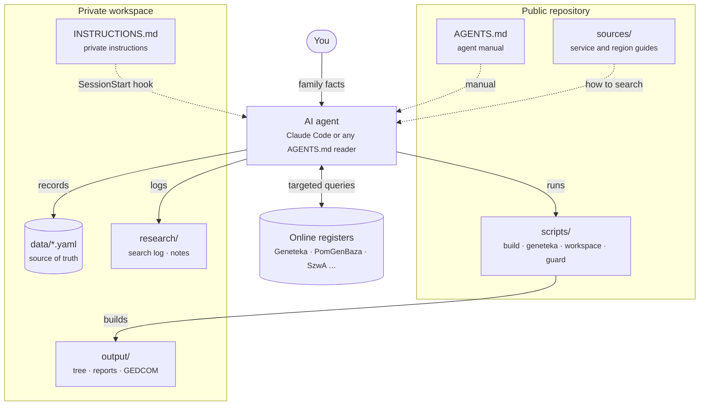
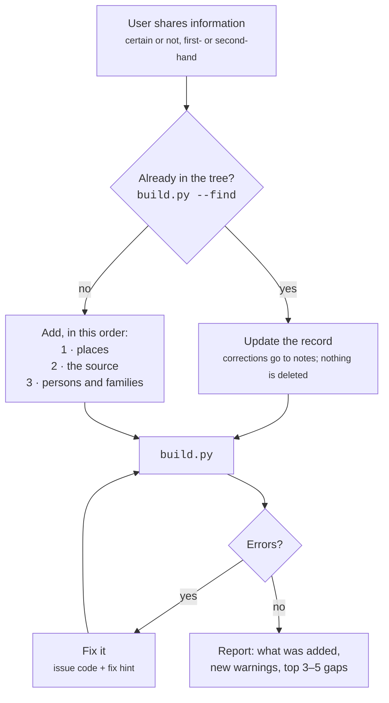
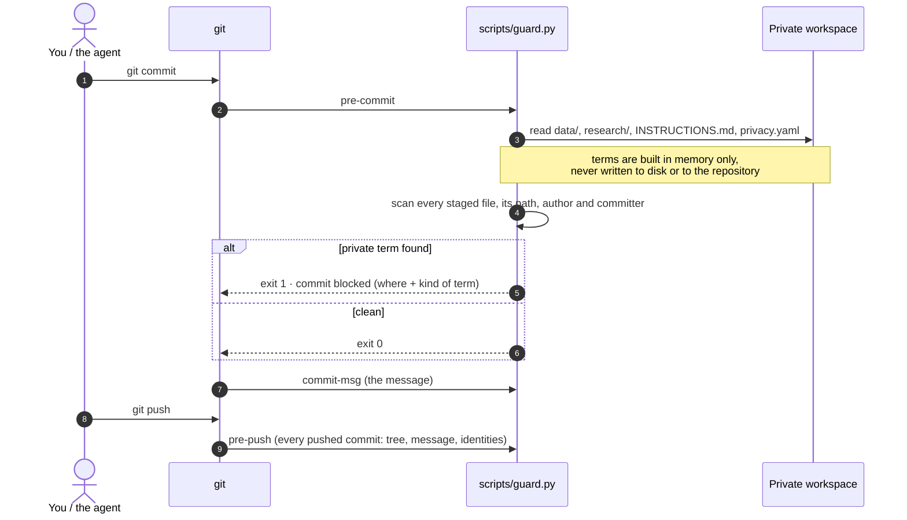

<div align="center">

# my-family-tree-harness

**An agent-operated genealogy toolkit: your AI agent does the bookkeeping and the register
searches, and your family data stays private.**

[](https://github.com/kstiewe/my-family-tree-harness/actions/workflows/ci.yml)
[](LICENSE)


[Quick start](#-quick-start) · [Usage](#-usage) · [How it works](#-how-it-works) · [Outputs](#-outputs) ·
[Privacy model](#-privacy-model) · [Commands](#-commands) · [Contributing](#-contributing)

</div>

---

## ✨ At a glance

| You | The agent | You get |
|---|---|---|
| Tell it what you know, however vague: *"grandma was probably born near Wzorcowo"* | Records every clue in plain YAML with its source, confidence and informant | One validated source of truth in `data/*.yaml` |
| Ask it to dig further | Runs targeted searches in online registers (Geneteka, PomGenBaza, Szukaj w Archiwach …) and logs every result, negative ones too | Candidates with scans, signatures and transcriptions in the original language |
| Read the result | Builds and validates, then reports errors, chronology warnings and the next gaps | An interactive tree, Mermaid diagrams, an ancestor list, a gap report, GEDCOM |

> [!IMPORTANT]
> **Your family data never lives in this repository.** It lives in a separate, private
> *workspace*. A privacy guard loads your private terms at run time and blocks every commit or
> push that contains names, places, dates, IDs or record URLs from it.

### Highlights

| | Feature | Details |
|---|---|---|
| 🤖 | **Agent-first** | [`AGENTS.md`](AGENTS.md) is the main interface; machine-readable CLI (`--json`, `--schema`) with stable issue codes and fix hints |
| 🗂️ | **Plain-text data** | Five YAML files, diff-friendly, kept in your own private git repository |
| ✅ | **Validation** | 32 issue codes: broken references, cycles, impossible chronology, unknown fields, unused sources … |
| 🔎 | **Research support** | Gap report with ready-made Geneteka links; guides to services and regions in [`sources/`](sources/README.md) |
| 🌍 | **Multilingual** | UI in English or Polish; the original language of every document (`la`, `de`, `ru`, `pl` …) is recorded |
| 🔒 | **Privacy guard** | `pre-commit`, `commit-msg`, `pre-push` hooks plus a generic CI check; fails closed |
| 🧪 | **Fictional sample family** | A complete example workspace; every test and example uses it |

---

## 🧭 How it works

### Architecture: public application, private workspace



| Layer | Lives in | Public? | Contents |
|---|---|:---:|---|
| Application | this repository | ✅ | code, agent manual, source guides, fictional example, tests |
| Workspace | its own directory, ideally a private git repo with no remote | ❌ | family data, research log, private agent instructions, guard terms |
| Outputs | `<workspace>/output/` | ❌ | generated on every build, never edited by hand |

### The agent's loop for new information



### What a record looks like

<table>
<tr><th><code>data/persons.yaml</code></th><th><code>data/sources.yaml</code></th></tr>
<tr><td>

```yaml
- id: I0015
  given: Wojciech
  surname: Kowalski
  variants: [Adalbertus, Войцех Ковальский]
  sex: M
  living: false
  birth: {date: "~1870", note: "age 28 at
          marriage, 55 at death"}
  death: {date: "1925-06-02", place: P0001,
          age: 55, sources: [S0004]}
  occupation: [farmer]
```

</td><td>

```yaml
- id: S0003
  type: marriage_record
  title: "Marriage record no. 15/1898,
    Roman Catholic parish of Wzorcowo"
  signature: "fonds 0000, unit 00"
  quality: image
  language: ru
  transcription: |
    Состоялось в деревне Взорцово
    15 ноября 1898 года …
  notes: "Russian-language record
    (Congress Poland after 1868)"
```

</td></tr>
</table>

<sub>Excerpts from the fictional sample family in <a href="examples/sample-family/"><code>examples/sample-family/</code></a>. Full model: <a href="docs/data-format.md">docs/data-format.md</a> or <code>python3 scripts/build.py --schema</code>.</sub>

---

## 🚀 Quick start

**Requirements:** Python 3.12+ and PyYAML. Node.js is optional (used only by the tests to check the page's JavaScript).

```bash
pip install pyyaml
python3 scripts/guard.py install                                  # 1. git hooks with the privacy guard
python3 scripts/workspace.py init ~/family-tree --lang en --git   # 2. your private workspace
python3 scripts/workspace.py link ~/family-tree                   # 3. remember it (git-ignored .workspace)
python3 scripts/build.py                                          # 4. validate + outputs in ~/family-tree/output/
```

Then open this directory in Claude Code and start telling it about your family. At session start a
hook hands the agent the workspace summary and your private `~/family-tree/INSTRUCTIONS.md`.

<details>
<summary><b>Try it first on the fictional sample family</b></summary>

```bash
python3 scripts/build.py --workspace examples/sample-family --out /tmp/sample-tree
```

```text
Persons: 20 (ancestors of the proband: 18) · families: 9 · places: 6 · sources: 9
warning: S0009: source is not attached to any fact
warning: I0013 Karol Nowak: birth (1912) after the father's death (1910)
Next free IDs: I0022 F0010 P0007 S0010
```

Open `/tmp/sample-tree/tree.html` in a browser. Both warnings are intentional: they show what the
validator reports.

</details>

### Where the workspace is found

| Priority | Source | Typical use |
|:---:|---|---|
| 1 | `--workspace PATH` | one-off commands, scripts |
| 2 | `FAMILYTREE_WORKSPACE` | shells, CI of your private repo |
| 3 | current directory or a parent containing `data/project.yaml` | working inside the workspace |
| 4 | `.workspace` file in the application root (git-ignored) | the default after `workspace.py link` |
| 5 | `~/.config/familytree/workspace` | `workspace.py link --user`, several app checkouts |

---

## 📖 Usage

You talk to the agent in plain language and it does the rest. You never need to edit YAML or
remember commands, though you can.

### A typical session

| # | You | The agent |
|:---:|---|---|
| 1 | Start Claude Code in this directory | loads the workspace summary and your private instructions (SessionStart hook) |
| 2 | Tell it what you know, in your own words | checks for duplicates, records places → source → persons and families, runs the build |
| 3 | Read its short report | lists what was added, new warnings and the 3–5 most important gaps |
| 4 | Ask it to research a gap | reads the guides and the search log, queries the registers, records candidates, logs every search |
| 5 | Look at the tree | opens `output/tree.html` or serves it on localhost |
| 6 | Ask it to commit | saves the data in the workspace's private git repository |

### Example (fictional sample family)

```text
You    › Grandma Zofia's father was Władysław Zieliński, a blacksmith from Bezparafie.
         I think he died in the war. I don't know her mother's name.

Agent  › Zofia Zielińska is already in the tree (I0008); Władysław is new.
         Added     · Władysław Zieliński (I0022), blacksmith, from Bezparafie (P0006);
                     "died in the war" kept in notes, marked probable
                   · family F0010: Władysław + unknown wife → Zofia
                   · oral source S0010 (informant: you, today)
         Warnings  · none new
         Gaps      1. Zofia's birth record: Bezparafie has no parish yet; find it first
                   2. Władysław's death: parish death records 1939–1945
                   3. Zofia's mother: Zofia's marriage record names both parents
```

### Things you can ask for

| Ask for | Say something like | You get |
|---|---|---|
| New facts | *"Grandpa's brother Henryk emigrated to Canada after the war."* | data with an oral source; uncertain facts marked as such |
| Next steps | *"What should we look for next?"* | the top gaps from `gaps.md`, with ready-made Geneteka links |
| Research | *"Find Józef Kowalski's birth record, Przykładowo, 1905."* | candidates with confidence, scan links and a log entry |
| A consistency check | *"Is anything in the tree contradictory?"* | validation errors and chronology warnings, explained |
| The tree | *"Show me the tree."* | `tree.html` in a browser or published as a private artifact |
| Something to share | *"Make a GEDCOM without living people."* | `build.py --public` output for Gramps, MyHeritage … |

### Viewing the tree yourself

```bash
python3 scripts/build.py                          # regenerate output/
python3 scripts/workspace.py serve --port 8765    # http://127.0.0.1:8765/tree.html (Polish: drzewo.html)
```

### Other ways to use it

| Setup | How |
|---|---|
| Another agent | any agent that reads `AGENTS.md` works; run `python3 scripts/workspace.py context` at the start of a session, since the hook is Claude-specific |
| No agent | edit `data/*.yaml` yourself (see [docs/data-format.md](docs/data-format.md)) and run `build.py`; the same validation applies |
| Updating the app | `git pull`; your data lives elsewhere and the format stays backwards compatible |

---

## 📦 Outputs

Every build regenerates `<workspace>/output/`. File names follow the report language.

| Output | `language: en` | `language: pl` | What it is |
|---|---|---|---|
| 🌳 Interactive tree | `tree.html` | `drzewo.html` | generation lanes, line highlighting, zoom, search; each person card opens with "At a glance" (who they were, where they lived, whom they lived with, what is worth knowing, the times they lived in — computed from the data, with sources; the card can be saved as a PNG); facts, sources, research hints; any person as the proband (only their ancestors, or also their ancestors' siblings and their own descendants); the current view saved as a sharp PNG; a Map view with the heatmap of births and deaths (the map below); works offline (web fonts aside) |
| 🧩 Embeddable tree | `tree-artifact.html` | `drzewo-artefakt.html` | the same page without the document skeleton, for hosts that add one (e.g. Claude artifacts) |
| 📈 Diagrams | `tree.mmd`, `ancestors.mmd` | `drzewo.mmd`, `przodkowie.mmd` | Mermaid: the whole tree and the line of ancestors |
| 📜 Ancestor list | `ancestors.md` | `przodkowie.md` | Kekule numbering with completeness per generation |
| 🕳️ Gap report | `gaps.md` | `luki.md` | missing facts with concrete research suggestions and Geneteka links |
| 🗺️ Map | `map.html`, `map-artifact.html` | `mapa.html`, `mapa-artefakt.html` | heatmap of births and deaths on Poland (with the partition borders) and the world, year filter, lines of ancestors, people per place; the map geometry is embedded |
| 🧭 Geography | `geography.md`, `geography.json` | `geografia.md`, `geografia.json` | clusters of places, migration trails along the lines of ancestors and where to look for missing ancestors — context for the agent |
| 🧬 GEDCOM | `tree.ged` | `drzewo.ged` | GEDCOM 5.5.1 for Gramps, MyHeritage, Ancestry, FamilySearch |

`--public` hides living persons in HTML, the map and GEDCOM. A person counts as living unless `living: false`
is set or a death or burial is recorded, when born less than 100 years ago or with no birth date
(great-grandparents and earlier excepted). The agent never searches for living people online.

---

## 🔒 Privacy model



### Layers of defence

| Layer | When | Checks | Needs workspace |
|---|---|---|:---:|
| `.gitignore` | always | ignores `data/`, `output/`, `research/`, `INSTRUCTIONS.md`, `privacy.yaml`, `.workspace`, `*.ged` | — |
| `pre-commit` | `git commit` | content and path of every staged file; author and committer identity | ✅ |
| `commit-msg` | `git commit` | the commit message | ✅ |
| `pre-push` | `git push` | every commit being pushed: full tree, message, identities | ✅ |
| CI (`--no-private`) | push, pull request | generic only: no workspace files outside `examples/`, `tests/` and the skeleton; no artifact links | — |
| `guard.py check` | before the agent writes public text | stdin | ✅ |

Without a workspace the guard **fails closed**. Contributors who have no family data set
`FAMILYTREE_GUARD_NO_PRIVATE=1` and run the generic checks only.

### What counts as a private term

| Kind | Built from | Matching |
|---|---|---|
| Surnames | `surname`, `married_surnames`, surname-like `variants`, project surnames | inflected forms (*Kowalski → Kowalskiego, Kowalscy*), spelling variants |
| Places | place names, aliases, project regions | inflected forms (*Wola → Woli*) |
| IDs | `I/F/P/S` IDs of the private data | exact, minus IDs the public example also uses |
| Dates | full event dates | `YYYY-MM-DD` and `DD.MM.YYYY` |
| Numbers | 5+ digit numbers in data, notes, instructions | exact (archive units, record IDs) |
| URLs | source URLs with a query or a long number; online-tree hosts | substring |
| Block list | `block:` in `privacy.yaml` | phrase |

Matching ignores case and Polish diacritics. Generic phrases (e.g. an archive's name) can be
allowed in `privacy.yaml`. That allow list stays private as well. More in
[docs/privacy.md](docs/privacy.md).

---

## 🧰 Commands

| Command | Purpose |
|---|---|
| `build.py` | validate and generate all outputs; prints errors, warnings, next free IDs |
| `build.py --check` | validate only |
| `build.py --json` | the same result as JSON (issues with `code`, `record`, `message`, `fix`) |
| `build.py --find TEXT [--json]` | duplicate check; ignores diacritics, includes variants |
| `build.py --schema` | the data model as JSON |
| `build.py --public` | outputs without living persons |
| `build.py --lang en\|pl` | override the report language |
| `geneteka.py --help` | Geneteka search links, parish lists, surname overview |
| `workspace.py where · context · init · link · serve` | find, create and connect the workspace; preview the tree on localhost |
| `guard.py install · check · scan · audit · terms` | the privacy guard |
| `python3 -m unittest discover -s tests` | the test suite (fictional data only) |

All scripts live in `scripts/` and are run as `python3 scripts/<name>`.

<details>
<summary><b>Machine-readable output for agents</b> (<code>build.py --check --json</code>, sample family)</summary>

```json
{
  "ok": true,
  "language": "en",
  "counts": {"persons": 20, "ancestors": 18, "families": 9, "places": 6, "sources": 9},
  "errors": [],
  "warnings": [
    {
      "code": "chronology",
      "record": "I0013",
      "message": "I0013 Karol Nowak: birth (1912) after the father's death (1910)",
      "fix": "Check the dates and ages involved; mark doubtful facts with confidence and notes."
    }
  ],
  "next_ids": {"person": "I0022", "family": "F0010", "place": "P0007", "source": "S0010"}
}
```

<sub>Shortened.</sub>

</details>

### Language resolution

| Setting | Interface and reports | Precedence |
|---|---|:---:|
| `--lang pl` | this run | 1 |
| `language: pl` in `data/project.yaml` | this workspace | 2 |
| `FAMILYTREE_LANG=pl` | this shell | 3 |
| *(none)* | English | 4 |

Code, comments and agent instructions are always in English. User-facing strings go through
`familytree.i18n.tr()`, with catalogs in [`familytree/locales/`](familytree/locales/).

---

## 📁 Repository layout

```text
my-family-tree-harness/
├── AGENTS.md            ← the agent's manual: the main interface of the application
├── CLAUDE.md            ← Claude Code specifics (imports AGENTS.md)
├── familytree/          ← Python package: model, validation, reports, HTML, GEDCOM, i18n, guard
│   ├── locales/         ←   translations (pl.py); add a language by copying it
│   ├── templates/       ←   the HTML pages: tree, diagram layout (layout.js, runs in the page), map
│   └── skeleton/        ←   what `workspace.py init` creates
├── scripts/             ← entry points: build · geneteka · workspace · guard
├── sources/             ← guides to services and regions, plus browser helpers (*.js)
│   └── regions/         ←   one guide per region (first: Pomerania)
├── docs/                ← data format · privacy model · research guide
├── examples/
│   └── sample-family/   ← a complete fictional workspace
├── tests/               ← unittest suite, fictional data only
├── .githooks/           ← pre-commit · commit-msg · pre-push → guard.py
└── .claude/             ← SessionStart hook, preview configurations
```

```text
<your workspace>/        (private, never pushed to a public remote)
├── INSTRUCTIONS.md      ← private agent instructions: artifact URLs, focus regions, open leads
├── privacy.yaml         ← extra blocked terms, allowed generic phrases
├── data/                ← project · persons · families · places · sources (.yaml)
├── research/            ← log.md (every search, negative results too) and notes
└── output/              ← generated, see Outputs
```

---

## 📚 Documentation

| Document | Read it for |
|---|---|
| [AGENTS.md](AGENTS.md) | how the agent works with the data and the user |
| [docs/data-format.md](docs/data-format.md) | the YAML data model, field by field |
| [docs/privacy.md](docs/privacy.md) | what is private, how the guard works, contributing safely |
| [docs/research-guide.md](docs/research-guide.md) | research stages and record types by partition |
| [sources/README.md](sources/README.md) | index of service and region guides, and how to write one |

### Source guides

| Guide | Covers |
|---|---|
| [overview](sources/overview.md) | all services at a glance: indexes, scans, gazetteers, abroad |
| [geneteka](sources/geneteka.md) | national index of births, marriages and deaths (PTG) |
| [pomgenbaza](sources/pomgenbaza.md) | parish and civil registers of Pomerania |
| [szukajwarchiwach](sources/szukajwarchiwach.md) | scans from the Polish State Archives |
| [german-sources](sources/german-sources.md) | CompGen: Verlustlisten (WWI casualty lists), address books, GEDBAS; German gazetteers |
| [graves](sources/graves.md) | grave databases (Grobonet, eCmentarze …) |
| [gazetteers](sources/gazetteers.md) | finding villages and their parishes |
| [regions/pomerania](sources/regions/pomerania.md) | Pomerania / former West Prussia |
| [regions/western-territories](sources/regions/western-territories.md) | Western and Northern Territories: lands German until 1945, settler families after 1945 |

The toolkit targets research in Polish lands across all three partitions. The guides are meant to
grow: new regions and services are the most valuable contributions.

---

## 🤝 Contributing

Contributions to the code, translations and especially the service and region guides are welcome.

- [ ] Examples and tests use **only** the fictional sample family (Kowalski, Nowak, Przykładowo …)
- [ ] `python3 -m unittest discover -s tests` passes
- [ ] The guard is installed (`python3 scripts/guard.py install`); never commit with `--no-verify`
- [ ] No family data on your machine? Use `FAMILYTREE_GUARD_NO_PRIVATE=1`
- [ ] New user-facing text is wrapped in `tr()` and translated in every catalog
- [ ] The data format stays backwards compatible

---

## 📄 Licence

GNU General Public License v3.0 or later (see [LICENSE](LICENSE)): you may use, study, share and
modify the software; copies and derived versions must stay open source under the same licence.

Additional permission under GNU GPL version 3 section 7: the files the software generates from your
data (HTML, Markdown, Mermaid, GEDCOM), including the parts of the page template embedded in them,
may be used and distributed under terms of your choice.

---

<details>
<summary><b>Po polsku w skrócie</b></summary>

Narzędzie do budowy drzewa genealogicznego obsługiwane przez agenta AI. Dane rodziny leżą w
osobnym, prywatnym katalogu (workspace), a strażnik prywatności blokuje commity, które by je
zawierały. Język interfejsu: `language: pl` w `data/project.yaml`.

</details>
